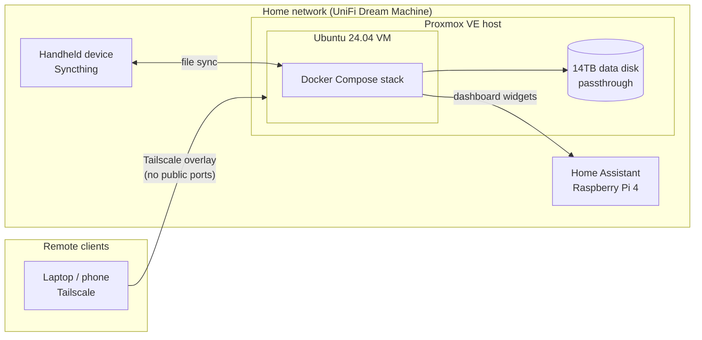

# Homelab

A self-hosted platform running on Proxmox VE: one Ubuntu 24.04 VM, a dozen containerized services in a single Docker Compose stack, private remote access over Tailscale, and built-in monitoring. Everything here can be rebuilt from scratch with this runbook.

## Architecture



## Design decisions

- **Zero public exposure.** No ports are forwarded on the router. All remote access goes through a Tailscale overlay network, and new users are invite-only.
- **Config is separate from data.** Service configs live on the VM's root disk (`./<service>/`). Media and synced data live on a passthrough disk, so the VM can be rebuilt without touching data.
- **One declarative stack.** Every service is defined in `docker-compose.yml`, and secrets live in `.env`. Portainer gives a UI on top of the stack but is not the source of truth.
- **Observability by default.** Uptime Kuma tracks service health, Glances tracks host metrics, Speedtest Tracker tracks the ISP connection, and a cron job logs disk-pressure warnings to journald.

## Services

| Category | Service | Port | Purpose |
|---|---|---|---|
| Dashboard | Homepage | 3000 | Single dashboard for all services |
| Management | Portainer | 9000 | Container management UI |
| Monitoring | Uptime Kuma | 3001 | Service uptime and alerting |
| Monitoring | Glances | 61208 | Host CPU, memory, disk, and container metrics |
| Monitoring | Speedtest Tracker | 8082 | Scheduled ISP speed tests |
| Media | Jellyfin | 8096 | Media streaming |
| Media | Navidrome | 4533 | Music streaming |
| Library | Kavita | 5000 | Books and comics |
| Library | RomM (+ MariaDB) | 8081 | Game library manager |
| Files | File Browser | 8080 | Web file manager for the data disk |
| Sync | Syncthing | 8384 | Peer-to-peer sync with edge devices |

Supporting devices on the network: a UniFi Dream Machine (gateway/firewall) and Home Assistant on a Raspberry Pi 4.

## Rebuild runbook

### 1. Pass the data disk through to the VM
In Proxmox, open the VM and go to **Hardware → Add → Hard Disk**, then attach the physical data disk.

### 2. Mount the data disk
```bash
sudo apt install exfatprogs -y
sudo mkdir -p /mnt/data
# Find the UUID with: sudo blkid
echo 'UUID=<disk-uuid> /mnt/data exfat defaults,uid=1000,gid=1000,umask=000,nofail 0 0' | sudo tee -a /etc/fstab
sudo mount -a && sudo systemctl daemon-reload
```
`nofail` lets the VM boot even if the disk is missing.

### 3. Install Docker
```bash
curl -fsSL https://get.docker.com | sh
sudo usermod -aG docker $USER && newgrp docker
```

### 4. Clone and configure
```bash
git clone https://github.com/benm0ra/homelab.git ~/homelab && cd ~/homelab
cp .env.example .env              # fill in every value
mkdir -p filebrowser/data
cp config/filebrowser/config.example.yaml filebrowser/data/config.yaml
mkdir -p /mnt/data/.docker/jellyfin/cache /mnt/data/roms
```

### 5. Start the stack
```bash
docker compose up -d
```

### 6. Private remote access
```bash
curl -fsSL https://tailscale.com/install.sh | sh
sudo tailscale up
tailscale ip -4   # add this IP to HOMEPAGE_ALLOWED_HOSTS in .env, then: docker compose up -d homepage
```

### 7. Disk monitoring
```bash
chmod +x scripts/*.sh
(crontab -l 2>/dev/null; echo "0 * * * * $HOME/homelab/scripts/disk-check.sh") | crontab -
```

## Post-rebuild checklist

- [ ] Set the Portainer admin password right away, because the setup window times out quickly
- [ ] Change the default passwords for RomM, File Browser, and Speedtest Tracker
- [ ] Generate Home Assistant and Speedtest Tracker API tokens and add them to the Homepage config
- [ ] Run the Jellyfin setup wizard and point the libraries at `/media`
- [ ] Create a local admin account on the UniFi gateway
- [ ] Re-pair edge devices in Syncthing
- [ ] Invite users to the tailnet and create their own Jellyfin accounts (no shared logins)

## Operations

```bash
docker compose ps                                   # status
docker logs -f <service>                            # logs
docker compose pull && docker compose up -d         # update all images
df -h / /mnt/data                                   # disk usage
sudo journalctl -t disk-check                       # disk alerts
```

## Troubleshooting: Syncthing on exFAT

exFAT has no Linux permission model, so Syncthing can fail with `permission denied` when it creates folders for a newly paired device. `scripts/fix-syncthing-exfat.sh` reads the failing paths from the container logs and pre-creates them. After running it, click **Rescan** in Syncthing.
